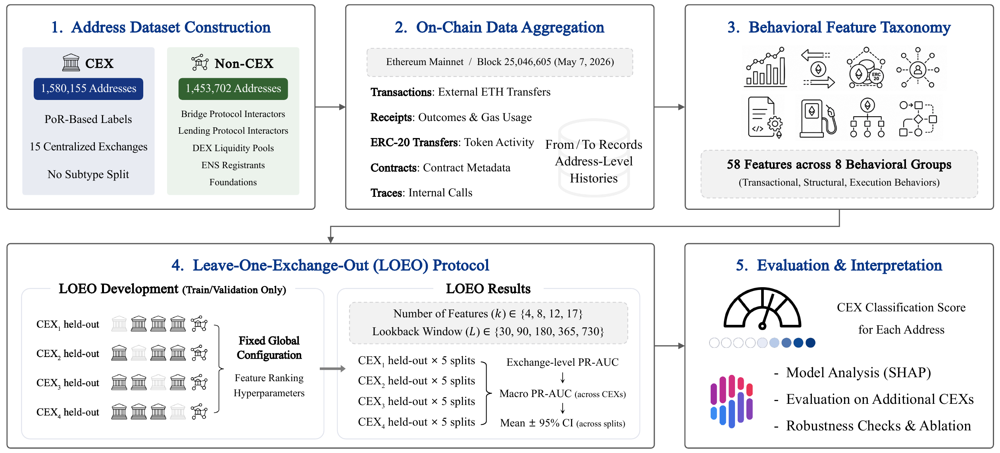

# On-Chain Behavioral Signatures for Classifying Centralized Exchange Addresses on Ethereum Using Proof-of-Reserves

Accepted at the 7th ACM International Conference on AI in Finance (ICAIF '26), November
14-17, 2026, Milan, Italy.

## Abstract

Centralized exchanges (CEXs) are key gateways between traditional finance and digital asset markets, yet identifying their blockchain addresses remains challenging. Existing approaches often rely on opaque attribution labels or treat exchanges as secondary classification targets, leaving generalization to unseen exchanges insufficiently examined. This study develops a classification framework using Proof-of-Reserves (PoR) disclosures, with 3,033,857 Ethereum addresses from 15 CEXs and five Non-CEX categories. We derive 58 on-chain behavioral features and evaluate LightGBM against logistic regression (LR) under a leave-one-exchange-out protocol. Across five lookback windows (30–730 days), LightGBM consistently outperformed LR, with macro PR-AUC increasing from 0.6611 to 0.9594 using the selected 17 features, compared with 0.7697 for LR at 730 days. Robustness checks showed comparable performance when feature selection and hyperparameter optimization were repeated across splits and held-out exchanges, while exchange-balanced reweighting improved macro PR-AUC. SHAP analysis and feature-group ablation identified gas behavior, ERC-20 token activity, and internal transactions as key predictive signals in the constructed dataset. These findings support interpretable CEX address screening for blockchain monitoring, while the released feature dataset enables reproducible follow-up research.

## Overview


Overview of the proposed CEX address classification framework with leave-one-exchange-out (LOEO) evaluation.

## Key results

Macro PR-AUC on the held-out exchange, averaged over five address-level splits, by feature budget ($k$) and lookback window ($L$, in days):

| $k$ | $L$ = 30 | $L$ = 90 | $L$ = 180 | $L$ = 365 | $L$ = 730  |
|---|----------|----------|-----------|-----------|------------|
| 4  | 0.6003   | 0.6491   | 0.6945    | 0.7832    | 0.9052     |
| 8  | 0.6253   | 0.6856   | 0.7368    | 0.8178    | 0.9212     |
| 12 | 0.6518   | 0.7256   | 0.7829    | 0.8700    | 0.9487     |
| 17 | 0.6611   | 0.7457   | 0.8049    | 0.8875    | **0.9594** |

The best configuration (17 features, 730-day lookback) reaches 0.9594, against 0.7697 for a logistic regression baseline under the same setup. Performance rises with both more features and longer history, and the lookback window matters more than the feature count at every budget size tested.

SHAP analysis on the best configuration attributes the largest share of model output to gas behavior (`avg_gas_used`, `avg_priority_fee_gwei`) and internal-transaction activity (`internal_tx_count_out`), with ERC-20 token behavior and counterparty structure contributing the rest. Full rankings and definitions are in [`docs/feature_dictionary.md`](docs/feature_dictionary.md).

## Dataset

The labeled dataset covers 3,033,857 unique Ethereum addresses: 1,580,155 CEX addresses (52.08%) from 15 exchanges via Proof-of-Reserves disclosures, and 1,453,702 Non-CEX addresses (47.92%) across bridge, lending, DEX, ENS, and foundation categories. Each address carries 58 behavioral features spanning transaction statistics, ETH and ERC-20 flow, counterparty structure, contract interaction, gas behavior, internal transactions, and composite activity patterns, computed over five lookback windows from 30 to 730 days. The full taxonomy is documented in [`docs/feature_dictionary.md`](docs/feature_dictionary.md), and the PoR page used for each of the 15 exchanges is listed in [`docs/data_sources.md`](docs/data_sources.md).

This repository does not include the raw address list, the feature extraction pipeline, or the experiment code used to produce the paper's results. Those stay in a private working environment; what's released publicly is a category-labeled feature dataset for follow-up research, available on request (see below).

## Data availability

Because the dataset is built from wallet-level on-chain behavior, it is shared on request rather than published outright. The request process isn't live yet.

**Request form: not yet available.** Once set up, a link will replace this line. In the meantime, reach out directly using the contact information below.

## Citation

```bibtex
@inproceedings{park2026onchain,
  title     = {{O}n-{C}hain {B}ehavioral {S}ignatures for {C}lassifying {C}entralized {E}xchange {A}ddresses on {E}thereum {U}sing {P}roof-of-{R}eserves},
  author    = {Park, Seongchan and Jeon, Hyunho and Kang, Byungsoo and Kim, Gaeun and So, Minseob and Kim, Seongyong},
  booktitle = {Proceedings of the 7th ACM International Conference on AI in Finance},
  year      = {2026},
  address   = {Milan, Italy},
  publisher = {ACM},
  doi       = {10.1145/3858063.3858815}
}
```

## Acknowledgments

The authors thank the anonymous reviewers for their feedback, as well as Daehyun Kim, the [Upbit DataLab](https://datalab.upbit.com/) team, and [Lambda256](https://www.lambda256.io/) for their support during this research.
